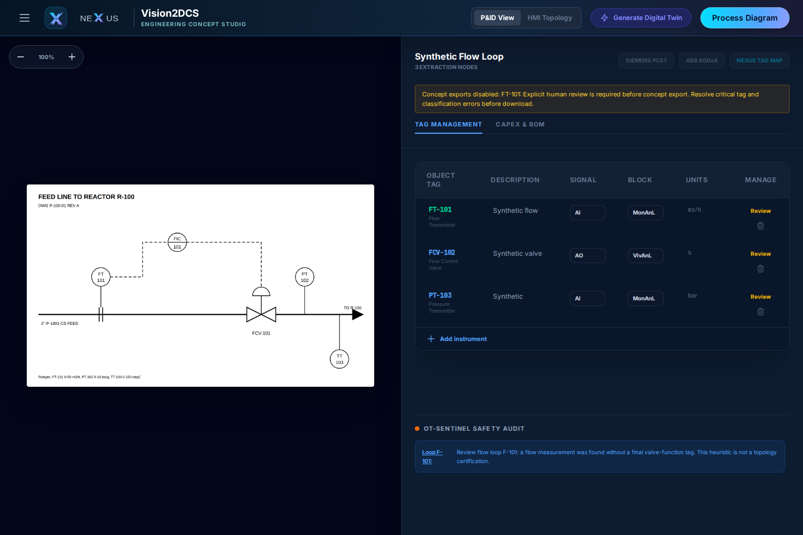
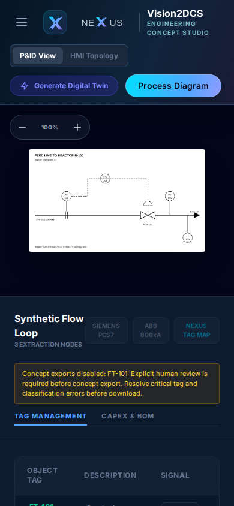

# Vision2DCS — P&ID-to-HMI Engineering Assistant

**Technical reviewer brief:** [System evidence, reproducibility and operational limits](docs/hiring-summary.md).

**React · TypeScript · Gemini multimodal AI · React Flow · Structured instrumentation extraction**

Vision2DCS is an industrial AI prototype that turns P&ID interpretation into a structured engineering workflow. It analyzes instrumentation diagrams, drafts tag mappings, and produces visual topology concepts for modern DCS and HMI projects.



<sub>Captured from this repository in Chromium, 1440 × 960. The pictured P&ID and tag list are **synthetic offline demonstration fixtures**; no Gemini call or vendor import approval is implied.</sub>

<details><summary>Mobile preview · 390 × 844</summary>



</details>

Portfolio case study: [senanur-cetin.vercel.app/projects/vision2dcs](https://senanur-cetin.vercel.app/projects/vision2dcs)

## Why this project exists

Instrumentation engineers still spend significant time translating P&IDs into tag lists, control structures, and HMI drafts by hand. Vision2DCS demonstrates how multimodal AI can accelerate the early design phase of automation projects while keeping the output visible and reviewable.

## What it does

- Parses uploaded process diagrams with Gemini-powered multimodal analysis.
- Extracts instrumentation concepts into structured engineering data.
- Drafts HMI and topology views with React Flow components.
- Maps output toward DCS-centric thinking for platforms such as Siemens PCS 7 and ABB 800xA (CSV/XML exports are concept formats, not validated against the vendors' import schemas).
- Packages the result as an explorable React/Vite prototype for portfolio review.

## Architecture snapshot

- **Frontend:** React 19, TypeScript, Vite
- **AI layer:** `@google/genai` with Gemini-based image and text reasoning, called only from the server
- **Server:** a small Web-standard `/api` handler, served by Vite in development and by a Node server (`npm start`) in production
- **Visualization:** React Flow for topology and node mapping
- **Reference docs:** `TECHNICAL_GUIDE.md` for deeper implementation notes

## Local setup

### Prerequisites

- Node.js 20+
- npm
- A Google AI Studio API key

### Install

```bash
npm install
cp .env.example .env.local
```

Set `GEMINI_API_KEY` in `.env.local`. The key is read only on the server. The browser calls `/api/analyze` and `/api/digital-twin` and never sees the key.

| Variable | Default | Purpose |
|----------|---------|---------|
| `GEMINI_API_KEY` | (required) | Google AI Studio key |
| `GEMINI_ANALYSIS_MODEL` | `gemini-3-flash-preview` | Model for P&ID extraction |
| `GEMINI_IMAGE_MODEL` | `gemini-2.5-flash-image` | Model for the digital-twin render |
| `PORT` | `3000` | Port for `npm start` |

### Run

```bash
npm run dev
```

### Type check and tests

```bash
npm run typecheck
npm test
```

### Build and run in production

```bash
npm run build
GEMINI_API_KEY=... npm start
```

`npm run build` writes the app to `dist/` and the server to `dist-server/`. `npm start` serves both on `PORT`. The server limits each client to 20 AI requests per minute, accepts images up to 10 MB, and retries rate-limited or transient Gemini failures with backoff. The rate limit is held in memory per process and keyed by client IP, so it assumes a single instance that is not behind a shared proxy.

## Measuring extraction quality

`samples/` holds synthetic P&IDs drawn for this repository. Each has an SVG source, the rendered `drawing.png` and a hand-checked `expected.json`. To run the benchmark against the configured model:

```bash
npm run eval
```

The benchmark prints per-sample missed and unexpected tags plus overall tag precision, recall and F1, and signal/block type accuracy on the matched tags. On successful completion it retains a unique report in **`eval/results/runs/`** and atomically updates **`eval/results/latest.json`** with model identifier, timestamp, per-sample input SHA-256 hashes and microaveraged metrics, so successive results can be inspected against the exact source drawings and labels. This file is ignored by Git and is **not** a synthetic score or automatic CI output. Running `npm run eval` makes real, potentially billable Gemini calls; it requires `GEMINI_API_KEY` and is not part of CI. CI tests only the offline report builder and validates that sample fixtures remain well-formed. To add a case, create `samples/<name>/` with a `drawing.png` and an `expected.json` that follows the existing ones. A field may list several accepted values, for example a controller as `["AI", "AO"]`.

### Compare two real benchmark runs without another Gemini call

Use two locally retained, real `eval/results/runs/*.json` files. Compare only **paired, identical sample source revisions**:

```bash
npm run eval:compare -- eval/results/baseline.json eval/results/candidate.json
```

This offline command verifies the report schema, source drawing/label SHA-256 hashes, unique sample names, scoring counts and recalculated microaveraged summaries. It prints baseline/candidate precision, recall, F1, matched-tag type accuracies and their signed deltas. A changed data set, forged summary, corrupt report or different label file fails rather than producing a misleading comparison. Reports must first be generated by explicitly authorized `npm run eval` runs; **CI neither runs Gemini nor fabricates benchmark results**. The command does not interpret changes as statistically significant or certified engineering quality.

## Manual engineering edits and project backup
The P&ID editor supports review-required low-confidence manual tag entries, spreadsheet-safe estimated BOM CSV export and versioned JSON backups. Imported/exported backup files share a 48 MiB UTF-8 limit (a 25 MiB raw drawing can require about 34 MiB in base64); oversize exports fail visibly rather than creating unrestorable backups, re-normalized, and stripped of external/SVG image URLs. All vendor CSV/XML formats remain conceptual until verified against vendor import tools.

## Limitations

- **AI output needs review.** Extracted tags, `connectedTo` links and especially the BOM brands and costs are model estimates, not engineering data. The OT-Sentinel audit flags common problems but is not a substitute for a check by an engineer.
- **Exports are concept formats.** The PCS 7 CSV and 800xA XML are well-formed but have not been validated against the vendors' import tools (#2).
- **Fail-closed concept export buttons.** The UI blocks Siemens/ABB concept downloads while tag identity errors (including canonical duplicates or invalid ISA-style tag names) or unresolved signal/PCS 7 block classifications remain. Fix the highlighted tags first. A cleared heuristic audit does not prove vendor compatibility, process safety, SIL or ISA certification.
- **Explicit local review.** Every model-extracted or imported instrument starts unreviewed, regardless of AI confidence or any review flag inside a JSON backup. The operator must click **Review** for each row after inspecting the drawing. Changing a tag, description, signal, block or units clears that approval; concept exports are disabled until all current rows have been reviewed. This local toggle is **not an authenticated engineering sign-off** or vendor safety certification.
- **NEXUS Tag Map v1.** A manually downloaded, [read-only versioned JSON contract](docs/NEXUS_TAG_MAP_V1.md) is available for locally reviewed and tag-valid projects. It deliberately omits credentials, drawings, plant measurements and control commands. No automatic cross-product synchronization is implemented.
- **Single-user storage.** Project history lives in the browser's `localStorage`, about 5 MB. A warning appears when it is full.
- **Single-instance server.** The rate limiter is in memory, and there is no authentication. Put the app behind your own access control before exposing it.
- **Preview models.** The default model names are preview releases and may change. Override them with the `GEMINI_*_MODEL` variables.

## Repository highlights

- `server/gemini.ts` contains the AI orchestration layer; `server/api.ts` is the HTTP contract in front of it.
- `services/` holds the browser-side logic: tag parsing, normalization, OT-Sentinel audit, exports, topology layout. All of it is unit tested.
- `components/HmiReactFlowView.tsx` drives the topology visualization.
- `eval/` and `samples/` hold the extraction benchmark.
- `TECHNICAL_GUIDE.md` documents the engineering intent in more depth. `CONTRIBUTING.md` lists the checks to run before a pull request.

## Engineering readiness

This is a human-in-the-loop **concept-generation tool**, not a validated PLC/DCS engineering exporter. Always independently review extracted tags, connections and bill-of-materials suggestions against source drawings and the target vendor's engineering tools.

## License

MIT


### Offline engineering acceptance regression

The `services/engineeringAcceptance.test.ts` suite exercises the **complete pure-data path** that supports the UI: an AI-created row starts unreviewed; an explicit local Review click can unlock conceptual export; creating a backup and importing it into a new project clears any asserted approval; changing a reviewed instrument invalidates that approval; and canonical duplicates prevent export. It also tests 12 MiB of valid inline image data and rejects malformed, remote and SVG image payloads. The backup image validator uses the shared linear-time canonical base64 scanner, avoiding a large regex on untrusted backups.

Run `npm test` for these offline checks. This is **not** a claim of real-browser keyboard/screenshot QA, paid Gemini accuracy, authenticated engineer sign-off, Siemens/ABB vendor import acceptance or actual plant control. Those remain separate release gates.
