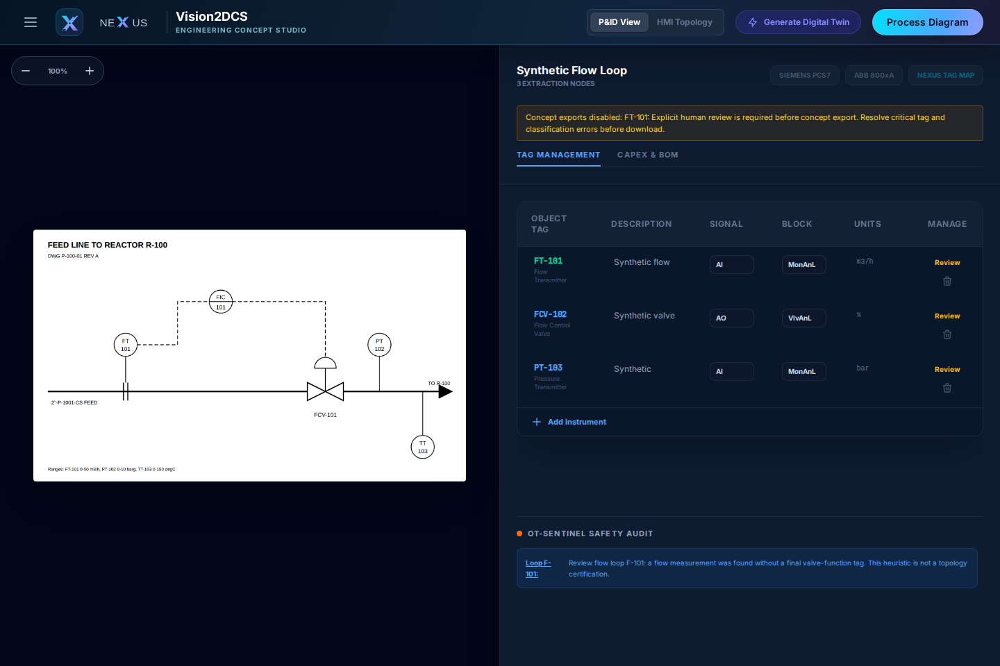
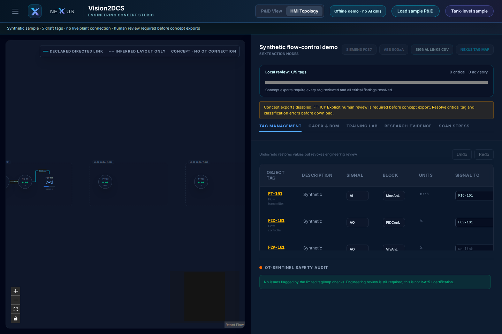
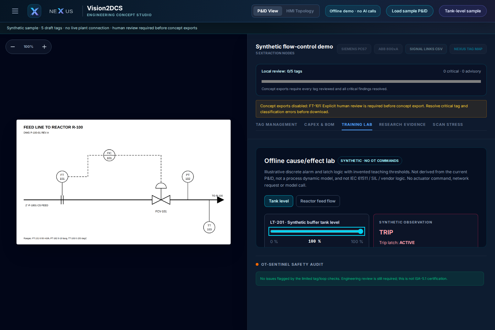
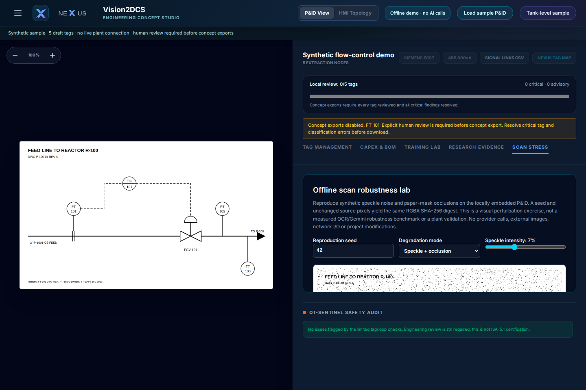

<div align="center">


# Vision2DCS

**P&ID interpretation · instrument tags · signal topology · offline engineering research**

[](https://github.com/senanurcetin/Vision2DCS/actions/workflows/ci.yml)
[](https://github.com/senanurcetin/Vision2DCS/actions/workflows/browser-smoke.yml)
[](https://github.com/senanurcetin/Vision2DCS/actions/workflows/ocr-baseline.yml)

</div>

Vision2DCS is a human-in-the-loop research demo that turns a process and instrumentation diagram (P&ID) into reviewed instrument tags, signal topology and early-stage HMI/DCS concept exports.

## Key results

- **10 labelled synthetic P&IDs** (2 schematic, 8 procedurally styled), each with a PNG, SVG source, reference instrument labels and annotated directed signal links.
- **Tesseract 5.3.4 OCR baseline** (`eng`, PSM 11), evaluated by CI on all 10 drawings: **precision 52.94% · recall 19.15% · tag F1 28.13%** ([CI run and artefacts](https://github.com/senanurcetin/Vision2DCS/actions/runs/39515173658)).

## Demo

[**Try the offline demo**](https://vision2dcs-nexus-demo.vercel.app/). No API key or account is needed. Select **Explore sample project** or **Explore tank-level study**; both start unreviewed and make no AI calls.



<sub>Offline synthetic flow-control exercise in Chromium. [Mobile view](docs/assets/nexus-workspace-mobile.png).</sub>

## Quick start

**Requirements:** Node.js **24.15+** (pinned to **24.22.0** in `.nvmrc`) and npm. No AI key is needed.

```bash
nvm use
npm ci
npm run dev
```

Open the URL printed by Vite. Paid AI routes are disabled by default.

Checks:

```bash
npm run typecheck
npm test
npm run eval:preflight
npm run eval:inspect
npm run docs:check
npm run build
```

`npm run build` creates the client `dist/` and Node server `dist-server/`; `npm start` serves them with paid AI off unless explicitly enabled.

## Features

| Workspace | What it does |
|---|---|
| **P&ID and Tag Management** | Two bundled hand-labelled synthetic drawings; edit instrument tags, assign signal/block concepts, local review and undo/redo |
| **HMI Topology** | React Flow loop diagrams: **cyan** lines are validated declared signal links; **gray dashed** lines are layout heuristics |
| **OT-Sentinel and BOM** | Heuristic tag/topology warnings, blocking export checks and partial cost estimates |
| **Training Lab** | Local cause/effect examples: tank high-level and reactor low-flow alarms, acknowledgement, sensor-fault UNKNOWN state and reset logic |
| **Research Evidence** | Read-only view of your own source-hashed v1/v2 evaluation JSON; per-drawing precision/recall/F1 and macro/micro summaries |
| **Scan Stress** | Seeded speckle noise and paper-mask occlusions on a local drawing, with before/after pixel SHA-256 hashes and a generated PNG |
| **Concept Exports** | Siemens PCS 7 CSV, ABB 800xA XML, directed signal-links CSV and NEXUS Tag Map v1 JSON, generated from reviewed tags only |

Projects with unknown or invalid classifications or critical graph errors cannot generate exports.

| Declared signal topology | Alarm training | Seeded scan perturbations |
|---|---|---|
|  |  |  |

## Evaluation

| Capability | Description |
|---|---|
| **Corpus preflight** | Checks PNG chunks and CRCs, reference labels and signal edges before any paid call |
| **Source-hashed scoring** | v1 tag-only and v2 directed-signal reports with drawing-level diagnostics and exact drawing/label identities |
| **OCR baseline** | Real CPU-only Tesseract run on the full corpus (results above) |
| **Paired comparison** | `eval:compare-tags` compares tag precision/recall/F1 across matching source hashes, including v1 OCR vs. v2 reports |

Reproduce without Gemini:

```bash
npm run eval:preflight        # validate all synthetic PNGs + labels
npm run eval:inspect          # unscored source-hashed corpus inventory
npm run eval:ocr              # optional: requires locally installed Tesseract + English data
npm run eval:diagnose -- eval/results/latest.json
npm run eval:compare-tags -- <baseline.json> <candidate.json>
```

`eval:ocr` writes source-hashed results to the gitignored `eval/results/` directory. `eval:diagnose` and `eval:compare-tags` read saved JSON and make no provider calls. `npm run eval` makes billable Gemini requests, requires `VISION2DCS_EVAL_MAX_CALLS` to cover the full corpus, and is never run in CI. See the [research methodology](docs/RESEARCH_EVIDENCE.md).

### Optional Gemini integration (off by default)

A `GEMINI_API_KEY` alone does not enable inference. Copy `.env.example` to `.env.local` and set all of:

- `GEMINI_API_KEY`: server-only provider key (never commit or send to the browser)
- `VISION2DCS_ENABLE_AI=true`: explicit opt-in
- `VISION2DCS_AI_ACCESS_TOKEN`: separately generated 32+ character shared operator secret
- `VISION2DCS_AI_MAX_REQUESTS`: per-process invocation allowance (1–1000)
- Optional `VISION2DCS_AI_MAX_CONCURRENT`: simultaneous operations (1–8; default 2)

The operator token stays in tab memory; the server validates it before accepting input. See [server boundary](TECHNICAL_GUIDE.md#server-boundary) and [Security Policy](SECURITY.md).

## Architecture

```text
App.tsx + components/ + hooks/    NEXUS UI, local state, review and experiments
services/                         Tag/graph contracts, OT-Sentinel, exports, simulation
server/                           Guarded model endpoints and server-only Gemini key
eval/ + samples/                  Synthetic reference drawings, scoring, OCR baseline
docs/                             Research notes, demo acceptance and data contracts
.github/workflows/                Offline CI, browser checks, CPU OCR measurement
```

**Stack:** React 19, TypeScript, Vite, Tailwind CSS 4, React Flow, Node.js 24; optional `@google/genai` server integration.

## Documentation

| Document | Purpose |
|---|---|
| [Technical Guide](TECHNICAL_GUIDE.md) | Runtime, engineering heuristics, exports, security and architecture |
| [Research Evidence](docs/RESEARCH_EVIDENCE.md) | Synthetic corpus, OCR baseline, scoring methodology and open questions |
| [Demo Evidence Matrix](docs/DEMO_EVIDENCE_MATRIX.md) | Features linked to tests and GitHub Actions runs |
| [Offline Demo Acceptance](docs/DEMO_ACCEPTANCE.md) | Step-by-step offline, research and browser checks |
| [NEXUS Tag Map v1](docs/NEXUS_TAG_MAP_V1.md) | Read-only JSON contract and local review rules |
| [NEXUS brand identity](docs/NEXUS_BRAND.md) | SVG source, palette and accessible use |
| [Contributing](CONTRIBUTING.md) · [Security](SECURITY.md) | Development practices, security reporting |

## Limitations

- **Research demo, not an operational product.** No plant-network connectivity, PLC/DCS writes, autonomous actuator actions, certified cause/effect logic or SIL rating. Every real design needs independent engineering validation, and real plant diagrams need their own privacy and rights approval.
- **Synthetic corpus only.** The eight procedural drawings share one drawing grammar, so they are not independent real-plant data. The bundled demo tags are reference labels, not model predictions.
- **Not yet measured:** live Gemini accuracy, an independently authored multi-style corpus, second-annotator agreement, generalization, scan-noise robustness (Scan Stress is reproducible but unscored) and multi-target signal graphs. Passing unit and browser tests says nothing about model accuracy.
- **Heuristic outputs.** Gray dashed topology lines, OT-Sentinel warnings and BOM cost estimates are heuristics; the cost estimates are partial.
- **Local review only.** The Review buttons record local state, not a signed engineering approval.
- **Concept exports.** Vendor-style files are not verified vendor imports ([#2](https://github.com/senanurcetin/Vision2DCS/issues/2), [#88](https://github.com/senanurcetin/Vision2DCS/issues/88)).
- **Gemini access control** is a shared operator token with a request cap, not identity-based authentication or a spending limit.

## License

MIT; see [LICENSE](LICENSE).
