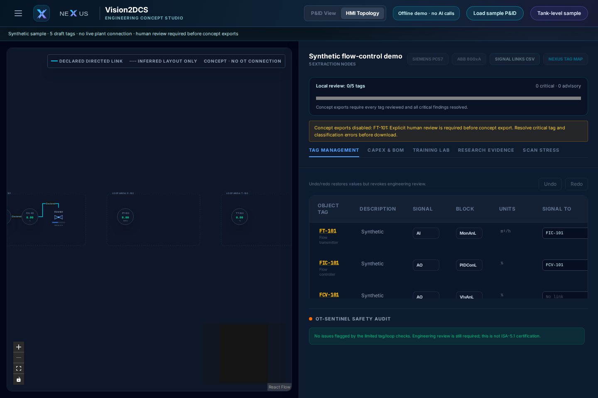
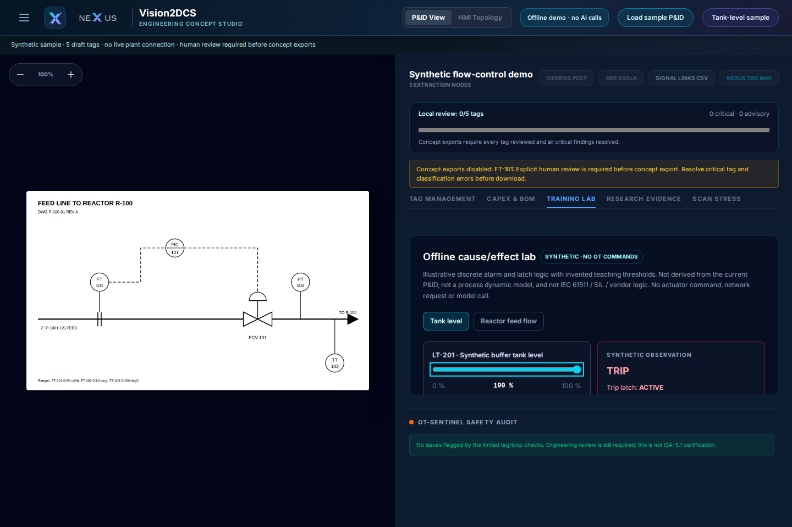
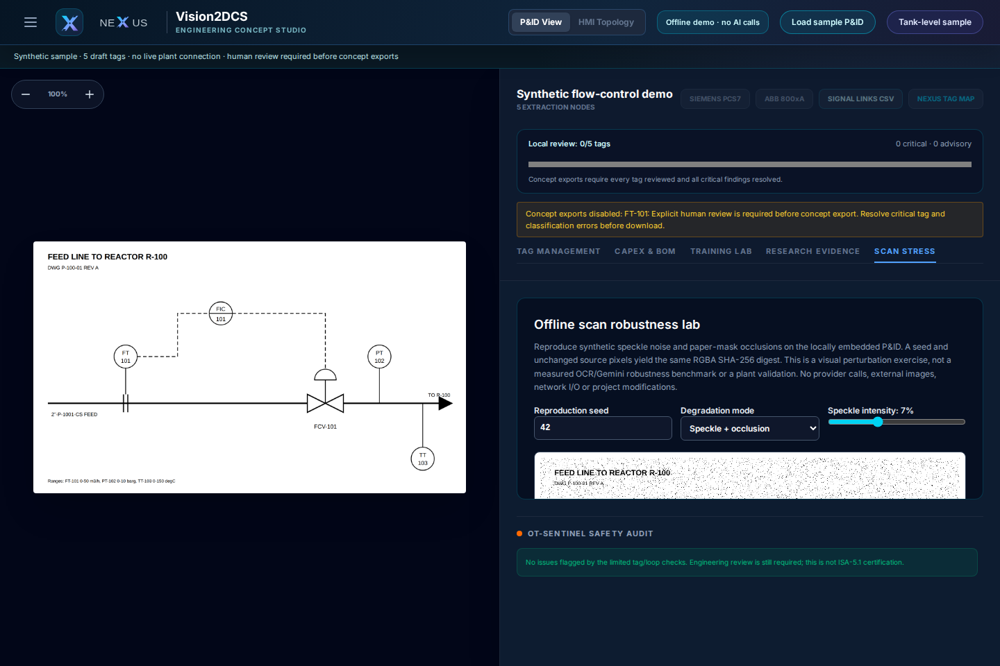

<div align="center">


# Vision2DCS

**P&ID interpretation · instrument tags · signal topology · offline engineering research**

A NEXUS-branded, human-in-the-loop industrial automation **research demo**, not a deployable PLC/DCS product.

[**Try the offline demo**](https://vision2dcs-nexus-demo.vercel.app/) · [**Technical architecture**](TECHNICAL_GUIDE.md) · [**Verified evidence**](docs/DEMO_EVIDENCE_MATRIX.md) · [**Research limitations**](docs/RESEARCH_EVIDENCE.md)

[](https://github.com/senanurcetin/Vision2DCS/actions/workflows/ci.yml)
[](https://github.com/senanurcetin/Vision2DCS/actions/workflows/browser-smoke.yml)
[](https://github.com/senanurcetin/Vision2DCS/actions/workflows/ocr-baseline.yml)

</div>


<sub>Real Chromium screenshot of the **offline synthetic** flow-control exercise. Displayed tags are reference examples, **not Gemini predictions** or verified plant engineering. [Mobile view](docs/assets/nexus-workspace-mobile.png).</sub>

## Explore the demonstration

Vision2DCS illustrates the review process between a process and instrumentation diagram (P&ID) and an **early-stage** HMI/DCS engineering concept. You can run the public demo without an API key or payment.

| Demo workspace | What you can inspect |
|---|---|
| **P&ID and Tag Management** | Two bundled, hand-labelled synthetic drawings; edit instrument tags, assign signal/block concepts, track explicit local review and undo/redo |
| **HMI Topology** | React Flow loop diagrams: **cyan** lines mean validated *declared* directed signal links; **gray dashed** lines are visualization heuristics, never plant wiring evidence |
| **OT-Sentinel and BOM** | Heuristic tag/topology warnings, blocking concept-export checks and explicitly partial, **unverified** cost estimates |
| **Training Lab** | Two fully local cause/effect learning examples: synthetic tank high-level and reactor low-flow alarms, acknowledgement, sensor-fault UNKNOWN state and reset logic |
| **Research Evidence** | Read-only validation and visualization of your own source-hashed v1/v2 evaluation JSON; per-drawing precision/recall/F1 and macro/micro summaries |
| **Scan Stress** | Seeded speckle noise and paper-mask occlusions on a local drawing; reproducible before/after **pixel** SHA-256 hashes and a generated PNG |
| **Concept Exports** | Reviewed-only, illustrative Siemens PCS 7 CSV, ABB 800xA XML, directed signal-links CSV and read-only NEXUS Tag Map v1 JSON |

**Use the browser demo:** select **Explore sample project** or **Explore tank-level study**. Both examples start **unreviewed**, make no AI calls and have no control-system connection. They illustrate the workflow; they do not prove P&ID recognition accuracy.

## Engineering preview

<details>
<summary>See the mobile NEXUS workspace</summary>


</details>

The visual review workflow intentionally distinguishes human changes, machine-suggested data and inferred layout. Local **Review** buttons are not a signed engineering approval. A project with unknown or invalid classifications or critical graph errors cannot generate reviewed concept exports.

### Additional browser-verified research views

| Validated declared signal topology | Synthetic alarm learning | Seeded scan perturbations |
|---|---|---|
|  |  |  |

<sub>Captured from real offline Chromium interactions. **Teaching thresholds, diagrams, and transformed pixels are synthetic**; none are real plant telemetry, certified interlocks, measured Gemini extraction results or verified vendor imports.</sub>

## Scientific evidence: implemented vs. measured

The repository includes **10 source-labelled synthetic P&IDs**: two initial schematic examples and eight procedurally styled cases. Every sample has a validated PNG, SVG source, reference instrument labels and annotated directed instrument-signal links. The procedural cases share a drawing grammar and **must not be treated as independent real-plant evidence**.

| Research capability | Evidence / interpretation |
|---|---|
| **Offline corpus preflight** | Checks complete PNG chunks and CRCs, reference labels and valid signal edges before any potentially paid call |
| **Source-hashed score reporting** | v1 tag-only and v2 directed-signal benchmark reports, validated totals, drawing-level diagnostics and exact drawing/label identities |
| **Real non-generative OCR baseline** | Tesseract 5.3.4 (`eng`, PSM 11), actually evaluated by CI on all 10 synthetic PNGs: **precision 52.94% · recall 19.15% · tag F1 28.13%** |
| **Fair paired comparison** | Offline `eval:compare-tags` compares only tag precision/recall/F1 across exactly matching source hashes, including v1 OCR against v2 reports |
| **Robustness illustration** | Seeded local perturbations are reproducible but **not** measured OCR or Gemini robustness results |

[**Real OCR execution and artefacts**](https://github.com/senanurcetin/Vision2DCS/actions/runs/39515173658) · [**Claim-to-evidence matrix**](docs/DEMO_EVIDENCE_MATRIX.md)

**Not established:** Live Gemini accuracy, an independently authored multi-style evaluation corpus, blinded second-annotator agreement, statistically supported generalization, measured scan-noise robustness or multi-target signal graph support. Unit-test and browser-test success must **not** be reported as AI model accuracy.

## Run locally (offline)

**Requirements:** Node.js **24.15+** (project-pinned **24.22.0** in `.nvmrc`), npm. No AI key, account or plant access required for the local demonstration.

```bash
nvm use
npm ci
npm run dev
```

Open the local URL printed by Vite. The application can load the bundled P&IDs, conduct research exercises, review tags and download concept files with **paid AI routes disabled**.

To verify the exact source state without spending on model calls:

```bash
npm run typecheck
npm test
npm run eval:preflight
npm run eval:inspect
npm run build
```

`npm run build` creates the client `dist/` and Node server `dist-server/`; `npm start` serves them with paid AI off unless explicitly enabled.

### Optional paid Gemini experiment — off by default

Only undertake this **separately** when you explicitly authorize external model processing and cost. A server-side `GEMINI_API_KEY` alone **does not** enable inference. Copy `.env.example` to `.env.local` and configure all of:

- `GEMINI_API_KEY`: server-only provider key (never commit or send to the browser)
- `VISION2DCS_ENABLE_AI=true`: explicit opt-in
- `VISION2DCS_AI_ACCESS_TOKEN`: separately generated 32+ character shared operator secret
- `VISION2DCS_AI_MAX_REQUESTS`: positive per-process invocation allowance (1–1000; **not** a monetary quota)
- Optional `VISION2DCS_AI_MAX_CONCURRENT`: simultaneous operations (1–8; default 2)

The locally entered operator token stays in tab memory; the server validates the authorization before consuming expensive input. This is **not identity-based user authentication or a spending guarantee**. Real plant diagrams require independent privacy, rights and engineering approvals. See [server and threat boundaries](TECHNICAL_GUIDE.md#server-boundary) and [Security Policy](SECURITY.md).

### Reproduce research without Gemini

```bash
npm run eval:preflight        # validate all synthetic PNGs + labels
npm run eval:inspect          # unscored source-hashed corpus inventory
npm run eval:ocr              # optional: requires locally installed Tesseract + English data
npm run eval:diagnose -- eval/results/latest.json
npm run eval:compare-tags -- <baseline.json> <candidate.json>
```

`eval:ocr` performs real **CPU-only OCR**, not a mock. It stores source-hashed results locally under the gitignored `eval/results/` directory. `eval:diagnose` and `eval:compare-tags` accept saved validated JSON and make **zero** provider calls. The optional `npm run eval` does make potentially billable Gemini requests and additionally requires an explicitly approved `VISION2DCS_EVAL_MAX_CALLS` covering the full corpus; it is never run by default CI. The [research methodology](docs/RESEARCH_EVIDENCE.md) describes exact comparison limits.

## Architecture

```text
App.tsx + components/ + hooks/    NEXUS UI, local state, review and experiments
services/                         Tag/graph contracts, OT-Sentinel, exports, simulation
server/                           Guarded model endpoints and server-only Gemini key
eval/ + samples/                  Synthetic reference drawings, scoring, real OCR baseline
docs/                             Scientific evidence, demo acceptance and data contracts
.github/workflows/                 Offline CI, browser checks, CPU OCR measurement
```

**Stack:** React 19, TypeScript, Vite, Tailwind CSS 4, React Flow, Node.js 24; an optional `@google/genai` server integration.

## Documentation

| Document | Purpose |
|---|---|
| [Technical Guide](TECHNICAL_GUIDE.md) | Runtime, engineering heuristics, exports, security and architecture |
| [Research Evidence](docs/RESEARCH_EVIDENCE.md) | Synthetic corpus, real OCR baseline, scoring methodology and unknowns |
| [Demo Evidence Matrix](docs/DEMO_EVIDENCE_MATRIX.md) | Audited claims linked to tests and GitHub Actions evidence |
| [Offline Demo Acceptance](docs/DEMO_ACCEPTANCE.md) | Step-by-step offline checks, research and browser acceptance |
| [NEXUS Tag Map v1](docs/NEXUS_TAG_MAP_V1.md) | Read-only JSON contract and strict local review limits |
| [NEXUS brand identity](docs/NEXUS_BRAND.md) | Local SVG provenance, palette and accessible use |
| [Contributing](CONTRIBUTING.md) · [Security](SECURITY.md) | Development practices, safe reporting |
| [Reviewer brief](docs/hiring-summary.md) | Concise project overview and what is independently supported |

## Boundaries and license

**Not a commercial or operational product.** No SaaS accounts, subscriptions, payments, plant-network connectivity, PLC/DCS writes, autonomous actuator actions, certified cause/effect or SIL claims. Vendor-style exports are **concept formats, not verified import files**. An engineer must validate every real design independently; see [vendor evidence gap #2](https://github.com/senanurcetin/Vision2DCS/issues/2) and [ongoing research #88](https://github.com/senanurcetin/Vision2DCS/issues/88).

MIT-licensed source code; see [LICENSE](LICENSE).
